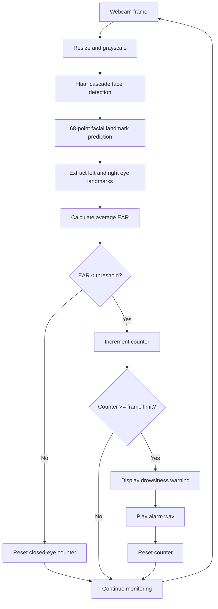

# Drowsy Detection

<p align="center">
  <strong>Real-time driver drowsiness detection using computer vision</strong><br>
  Detect prolonged eye closure through a webcam and trigger an audible warning.
</p>

<p align="center">
  
  
  
  
  
</p>

---

## Overview

**Drowsy Detection** is a Python-based computer vision application that monitors a driver's eyes through a webcam. It estimates whether the eyes remain closed for an extended sequence of frames and plays an audible alarm when the configured threshold is reached.

The application combines OpenCV face detection with dlib's 68-point facial landmark predictor. It calculates the **Eye Aspect Ratio (EAR)** for both eyes and uses a consecutive-frame counter to identify prolonged eye closure.

The project is intended as an educational prototype demonstrating real-time video processing, facial landmark analysis, and a simple event-triggered alert.

> **Safety disclaimer**
>
> This project is not a certified driver-monitoring system and has not been validated for use in vehicles or other safety-critical environments. It may miss drowsiness or trigger false alarms. Never use it as a substitute for sleep, breaks, safe driving practices, or certified driver-assistance technology.

## Demo

Run the application with a working webcam to see the live detection window. The application draws contours around the detected eyes and displays the current EAR value. When the low-EAR condition persists for the configured number of frames, it displays a warning and plays the alarm.

**Add your own screenshots here** after running the application. Save genuine captures in an `assets/` directory and use the suggested filenames below.

| Live webcam detection | Drowsiness alert |
|---|---|
|  |  |
| *Eye contours and live EAR value* | *Warning shown when the frame threshold is reached* |

*The image paths above are placeholders until you add the corresponding screenshots to the repository.*

## How it works

The detection pipeline follows these steps:

1. **Video capture** — read frames from the default webcam (camera index `0`).
2. **Pre-processing** — resize each frame to a width of 450 pixels and convert it to grayscale.
3. **Face detection** — locate face regions using OpenCV's Haar cascade classifier.
4. **Landmark extraction** — pass each detected face region to dlib's 68-point facial landmark predictor.
5. **Eye localisation** — extract the six landmark points for each eye.
6. **EAR calculation** — calculate left- and right-eye aspect ratios and average them.
7. **Temporal check** — count consecutive frames for which the average EAR is below the configured threshold.
8. **Alert** — display a drowsiness warning and play `alarm.wav` when the frame limit is reached.

### Detection pipeline



### Eye Aspect Ratio (EAR)

The **Eye Aspect Ratio** measures the relative openness of an eye using six landmark points around its boundary.

For eye landmarks (p_1, p_2, \ldots, p_6):

```text
             ||p2 - p6|| + ||p3 - p5||
EAR =       --------------------------------
                       2 ||p1 - p4||
```

The vertical distances decrease as the eye closes, while the horizontal eye width remains comparatively stable. Consequently, a lower EAR can indicate a closed or nearly closed eye.

This implementation calculates EAR separately for the left and right eyes, then takes their average:

```python
left_ear = eye_aspect_ratio(left_eye)
right_ear = eye_aspect_ratio(right_eye)
ear = (left_ear + right_ear) / 2.0
```

The application treats the eyes as closed when the average EAR is below `EYE_THRESHOLD` for enough consecutive frames. This is a simple heuristic, not a calibrated or medically validated measure of drowsiness.

## Technology stack

| Technology | Role |
|---|---|
| Python 3.10 | Application language |
| OpenCV | Webcam frame capture, image processing, and Haar cascade face detection |
| dlib | 68-point facial landmark prediction |
| imutils | Video stream utilities, resizing, and landmark helpers |
| SciPy | Euclidean distance calculations for EAR |
| Conda | Environment and dependency management |
| `afplay` / `playsound` | Alarm playback, depending on operating system |

## Repository structure

```text
DrowsyDetection/
├── models/
│   ├── haarcascade_frontalface_default.xml
│   ├── shape_predictor_68_face_landmarks.dat
│   └── shape_predictor_68_face_landmarks.dat.bz2
├── .vscode/
│   └── settings.json
├── Sleepy Driver.py
├── alarm.wav
├── environment.yml
└── README.md
```

| Path | Purpose |
|---|---|
| `Sleepy Driver.py` | Main application and drowsiness-detection loop |
| `models/haarcascade_frontalface_default.xml` | OpenCV Haar cascade face detector |
| `models/shape_predictor_68_face_landmarks.dat` | dlib's pre-trained 68-point facial landmark model |
| `models/shape_predictor_68_face_landmarks.dat.bz2` | Compressed copy of the landmark model |
| `alarm.wav` | Audio warning played when the alert condition is met |
| `environment.yml` | Conda environment definition |
| `.vscode/settings.json` | VS Code Python environment preferences |

**Model note:** The repository currently contains the model files. The uncompressed dlib predictor is approximately 100 MB, so cloning the repository may take longer than the Python source code alone would suggest.

## Getting started

### Prerequisites

- Python 3.10
- Conda or Miniforge
- A working webcam
- Speakers or headphones
- macOS, Windows, or Linux

Miniforge is a practical Conda distribution, particularly on Apple Silicon Macs.

### 1. Clone the repository

```bash
git clone https://github.com/VajraX14/DrowsyDetection.git
cd DrowsyDetection
```

### 2. Create and activate the environment

```bash
conda env create -f environment.yml
conda activate drowsy-detection
```

The supplied environment definition installs Python 3.10, dlib, OpenCV, SciPy, and imutils.

### 3. Install the audio dependency on Windows and Linux

On macOS, the application uses the built-in `afplay` command. On other operating systems, it imports `playsound`.

Install it inside the active Conda environment:

```bash
python -m pip install playsound==1.2.2
```

### 4. Verify the required files

Make sure these paths exist:

```text
models/haarcascade_frontalface_default.xml
models/shape_predictor_68_face_landmarks.dat
alarm.wav
```

The application checks for these files before starting. The model files are already present in the repository; there is no need to download them again when cloning the current repository.

### 5. Run the application

```bash
python "Sleepy Driver.py"
```

Allow camera access when your operating system prompts you. On macOS, camera permissions can be reviewed under **System Settings → Privacy & Security → Camera**.

The live window displays the eye contours and current EAR. Press **q** while the detection window is active to stop the application.

## Configuration

The main configuration constants are defined near the beginning of `Sleepy Driver.py`.

| Parameter | Current value | Description |
|---|---:|---|
| `EYE_THRESHOLD` | `0.30` | Average EAR below which the frame is counted as a closed-eye frame |
| `FRAMES_LIMIT` | `100` | Consecutive low-EAR frames required to trigger an alert |
| `CAMERA_INDEX` | `0` | Webcam device index |

These are implementation defaults, not universal thresholds. The real-time duration represented by 100 frames depends on the effective frame rate. Detection quality can also vary with camera placement, lighting, face orientation, occlusion, and individual facial characteristics.

## Current implementation notes

- The program monitors the webcam continuously until the user presses `q` or the video stream cannot provide a frame.
- The face detector uses the Haar cascade included in the repository.
- The dlib predictor runs on the grayscale frame and the face rectangle returned by OpenCV.
- The alert sound is played synchronously. Depending on the audio playback duration, this can temporarily interrupt frame processing.
- If more than one face is detected, the program iterates over the detected face regions and processes each one.

## Limitations

This is a compact prototype, with several limitations worth understanding:

- **Fixed threshold:** a single EAR threshold may not work equally well for every person or camera setup.
- **Frame-count timing:** the trigger is based on frame count rather than a measured duration, so alert latency varies with frame rate.
- **Face detection dependence:** poor lighting, head rotation, occlusion, and camera placement can reduce detection reliability.
- **Synchronous alarm:** audio playback can block the main processing loop while the sound is playing.
- **No calibration:** the application does not learn a driver's baseline EAR or adapt to individual characteristics.
- **No safety validation:** no clinical, road, or safety-critical performance evaluation is claimed.

## Potential improvements

The following would be useful next steps for taking the prototype further:

- Add a calibration phase and configurable thresholds.
- Use a time-based closed-eye duration instead of a fixed frame count.
- Move alarm playback to a background thread or non-blocking audio interface.
- Add robust handling for camera failures and face-loss conditions.
- Add configurable camera selection and runtime controls.
- Record detection events and basic performance metrics.
- Add automated tests for EAR calculation and threshold logic.
- Evaluate performance across different lighting, camera angles, and users.

## Contributing

Suggestions, bug reports, and improvements are welcome. For substantial changes, open an issue to discuss the proposed approach before submitting a pull request.

## License and model usage

No `LICENSE` file is currently present in this repository. Unless a license is added, the source code should be treated as copyrighted by its owner; do not assume that it is available for unrestricted reuse.

The dlib 68-point facial landmark predictor is associated with the iBUG 300-W dataset. Review the [dlib model documentation](https://github.com/davisking/dlib-models) and the applicable dataset terms before redistributing the model or using it commercially. The presence of a model file in this repository does not grant additional usage rights.

---

<p align="center">
  Built with Python and computer vision.
</p>
